# Software Architecture Document: Autonomous Job-Matching Agent & Application Proxy

- **Project**: `job-matching-agent`
- **Primary Stakeholder / Role**: Candidate / User
- **Document Version**: 1.3.0 (User Onboarding, Dynamic Skill Recency, Mobile Question Feed, Data & Deployment Architecture)
- **Status**: High-Level Design Specification (Requirements Finalization Phase — Microservice / Multi-Agent Ready)
- **Traceability**: Aligns with [`REQUIREMENTS.md` (v1.5.0)](file:///c:/ajay/GoLang/GoogleAgents/job-hunt-naukri/REQUIREMENTS.md) and [`Business Case_ Naukri Job-Matching Agent.html`](file:///c:/ajay/GoLang/GoogleAgents/job-hunt-naukri/Business%20Case_%20Naukri%20Job-Matching%20Agent.html)
- **Visual Blueprints**: [`component_diagram.html`](file:///c:/ajay/GoLang/GoogleAgents/job-hunt-naukri/component_diagram.html) &bull; [`architecture_visualization.html`](file:///c:/ajay/GoLang/GoogleAgents/job-hunt-naukri/architecture_visualization.html) &bull; [`mobile_and_sequence_visual.html`](file:///c:/ajay/GoLang/GoogleAgents/job-hunt-naukri/mobile_and_sequence_visual.html) &bull; [`figma_screens_visual.html`](file:///c:/ajay/GoLang/GoogleAgents/job-hunt-naukri/ui/figma_screens_visual.html)
- **Candidate Access Layer Specs**: [`ui/CANDIDATE_ACCESS_LAYER_PRD.md`](file:///c:/ajay/GoLang/GoogleAgents/job-hunt-naukri/ui/CANDIDATE_ACCESS_LAYER_PRD.md) &bull; [`ui/FIGMA_DESIGN_SYSTEM.md`](file:///c:/ajay/GoLang/GoogleAgents/job-hunt-naukri/ui/FIGMA_DESIGN_SYSTEM.md)

---

## 1. System Vision & Architecture Drivers

### 1.1 Executive Vision
The **Autonomous Job-Matching Agent** is a single-binary, mobile-first application proxy built in **Go 1.22+** with an embedded **React + Tailwind** Web User Interface. It provides an end-to-end customer workflow: customer login, portal credential provisioning, resume document ingestion, dynamic skill extraction with customizable **Years of Experience** and **Last Used Year**, predefined screening QA profiles, autonomous scheduled scanning across job portals, and dynamic LLM questionnaire resolution with mobile app alerts and 1-tap approvals.

### 1.2 Architectural Drivers & Quality Attributes (NFRs)
1. **End-to-End Mobile-First User Experience**: Clean, intuitive smartphone workflow: Login $\rightarrow$ Portal Credential Input $\rightarrow$ Resume Upload $\rightarrow$ Skill Recency Review $\rightarrow$ Predefined QA Setup $\rightarrow$ Mobile Question Feed.
2. **Account Integrity & Anti-Detection (Top Priority)**: Zero automated patterns that trigger portal anti-bot firewalls. Enforces randomized Gaussian pacing (8–25s) and human-in-the-loop (HITL) challenge resolution.
3. **Encrypted Portal Credential Vault**: Portal usernames and passwords entered via the mobile UI are encrypted at rest using AES-256-GCM. Decryption occurs strictly in-memory during active portal worker sessions.
4. **Dynamic Skill Extraction & Recency Modeling**: Discovers skills dynamically from uploaded resumes and allows candidates to adjust years of experience and last used year, eliminating outdated skill applications.
5. **Zero-Hallucination Proxy Answering**: Dynamic questionnaire answers must be strictly grounded in verified facts from the candidate's resume and skill matrix, backed by confidence scoring ($\ge 85\%$) and mobile app review.
6. **Single-Binary Portability**: Compiles to a self-contained executable with embedded static web assets (`//go:embed`). Runs locally with zero cloud dependencies or external database servers.

---

## 2. System Context (C4 Level 1)

The system operates locally within the candidate's environment, accessible from desktop or mobile browser, interfacing with target job portals, LLM reasoning engine, and local storage.

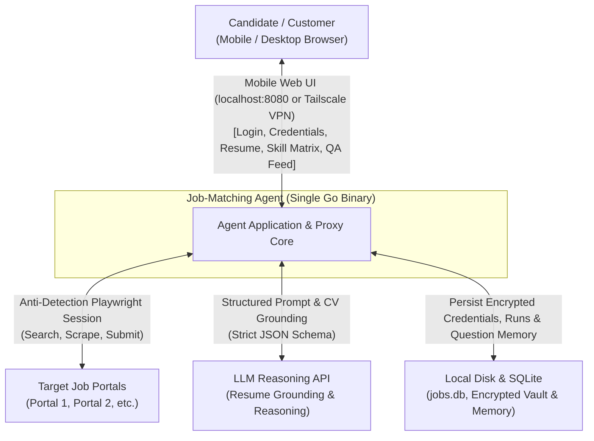

---

## 3. Container & Subsystem Architecture (C4 Level 2)

In this high-level design phase, the architecture establishes decoupled, domain-driven subsystem boundaries. While a single binary runtime is supported for streamlined local developer operations, all components are architected with isolated interfaces that can seamlessly scale into **discrete microservices** or a **specialized multi-agent system** (e.g. Crawler Agent, Matching Agent, QA Reasoning Agent) as deployment and operational requirements finalize:

```mermaid
flowchart TD
    subgraph ArchitectureBoundary["System Architecture & Service Boundaries (Microservice / Multi-Agent Ready)"]
        subgraph WebUI["Presentation & Ingress"]
            ReactApp["React 18 + Tailwind Mobile SPA\n(Login, Portal Vault, Resume Studio, Skill Recency, QA Feed)"]
        end

        subgraph APILayer["HTTP & Event Gateway (Chi Router)"]
            AuthMiddleware["JWT Authentication Middleware"]
            REST["REST API Endpoints (/api/v1/*)"]
            SSE["Server-Sent Events Broker (/api/v1/stream)"]
            StaticServer["Embedded Asset FileServer"]
        end

        subgraph CoreEngine["Domain Application Services"]
            AuthService["App Authentication Service (bcrypt)"]
            VaultService["Portal Credential Vault (AES-256-GCM)"]
            ResumeParser["Resume Parser & Text Extractor (PDF/DOCX)"]
            SkillExtractor["Dynamic Skill & Recency Extractor"]
            Scheduler["Cron Scheduler Engine (Mon-Sat 09:00 IST)"]
            Crawler["Playwright Browser Automation (Stealth Engine)"]
            Matcher["70% Matcher with Recency Decay Engine"]
            QAEngine["3-Tier Questionnaire Resolver (Pre-fill, LLM, Mobile Push)"]
            StateMachine["HITL State Machine (IDLE, RUNNING, AWAITING_INPUT)"]
        end

        subgraph Adapters["Infrastructure & External Adapters"]
            SecretMgr["File-Mounted Secrets Loader (go-secrets-file-mounted)"]
            Logger["Structured JSON Logger (go-logging-zerolog)"]
            LLMClient["LLM Reasoning Client Adapter"]
            DB["SQLite Repository (WAL Mode)\n(Users, Credentials, Skills, Applications, Memory)"]
        end
    end

    ReactApp <-->|"Fetch JSON & SSE Stream"| APILayer
    APILayer <--> CoreEngine
    CoreEngine <--> Adapters
```

---

## 4. Component Layout & Clean Architecture (C4 Level 3)

The internal Go codebase follows standard Go best practices and aligns with workspace skills:

```
job-matching-agent/
├── cmd/
│   └── job-agent/
│       └── main.go                  <-- Entrypoint (CLI commands & server boot)
├── internal/
│   ├── api/
│   │   ├── router.go                <-- Chi HTTP routing & CORS
│   │   ├── handlers_auth.go         <-- Customer login, token issuance
│   │   ├── handlers_portals.go      <-- Portal selection & encrypted credential input
│   │   ├── handlers_resume.go       <-- Resume upload (multipart) & parsing trigger
│   │   ├── handlers_skills.go       <-- Dynamic skill matrix CRUD (Years of Exp, Last Used)
│   │   ├── handlers_qa.go           <-- Predefined QA profile & Mobile Feed approvals
│   │   ├── sse_broker.go            <-- Server-Sent Events hub for live UI streaming
│   │   └── middleware.go            <-- JWT auth, Zerolog request logging & recovery
│   ├── auth/
│   │   └── auth.go                  <-- Password hashing (bcrypt) & JWT claim validation
│   ├── vault/
│   │   └── crypto.go                <-- AES-256-GCM portal credential encryption at rest
│   ├── resume/
│   │   ├── parser.go                <-- PDF / DOCX text extraction
│   │   └── extractor.go             <-- LLM/NLP dynamic skill extraction pipeline
│   ├── config/                      <-- Implements `go-config-env`
│   │   └── config.go                <-- Struct tags parsing with caarlos0/env
│   ├── secrets/                     <-- Implements `go-secrets-file-mounted`
│   │   └── secrets.go               <-- Loads runtime keys from ${SECRETS_PATH}
│   ├── logger/                      <-- Implements `go-logging-zerolog`
│   │   └── logger.go                <-- Structured JSON logging with PII sanitization
│   ├── errors/                      <-- Implements `go-errors-handling`
│   │   └── errors.go                <-- Domain error types & retryable classifications
│   ├── crawler/
│   │   ├── browser.go               <-- Playwright lifecycle, stealth profile & headers
│   │   ├── portal_connector.go      <-- Pluggable interface for job portal connectors
│   │   ├── submitter.go             <-- 1-click apply & DOM form element interaction
│   │   └── delay.go                 <-- Gaussian pacing & randomized typing cadence
│   ├── matcher/
│   │   ├── scoring.go               <-- Weighted 70% skill formula with recency verification
│   │   ├── ontology.go              <-- Technical synonym aliases dictionary
│   │   └── filters.go               <-- Hard boundary checks (experience, location, blacklist)
│   ├── qa/
│   │   ├── resolver.go              <-- 3-Tier orchestration pipeline
│   │   ├── tier1_prefill.go         <-- Deterministic regex & fuzzy field mapping
│   │   ├── tier2_llm.go             <-- LLM resume & skill-grounded reasoning
│   │   └── memory_store.go          <-- Question-answer cache & deduplication
│   ├── store/
│   │   ├── sqlite.go                <-- Connection pool, WAL pragmas, migrations
│   │   ├── repo_users.go            <-- Customer login credentials
│   │   ├── repo_portals.go          <-- Encrypted portal credentials & cookies
│   │   ├── repo_skills.go           <-- Candidate skill recency matrix
│   │   ├── repo_jobs.go             <-- Job application records CRUD
│   │   └── repo_memory.go           <-- Question memory persistence
│   └── scheduler/
│       └── runner.go                <-- Mon-Sat 09:00 cron lifecycle & killswitch
├── web/
│   ├── src/
│   │   ├── components/              <-- LoginScreen, PortalVault, ResumeUpload, SkillMatrix, QuestionFeed
│   │   ├── hooks/                   <-- useEventStream (SSE), useJobQuery
│   │   └── App.tsx
│   ├── dist/                        <-- Production build (HTML/JS/CSS)
│   └── embed.go                     <-- `//go:embed dist/*` asset distribution
├── Makefile
├── go.mod
└── go.sum
```

---

## 5. Detailed Subsystem Specifications & Sequence Flows

### 5.1 End-to-End User Onboarding Sequence

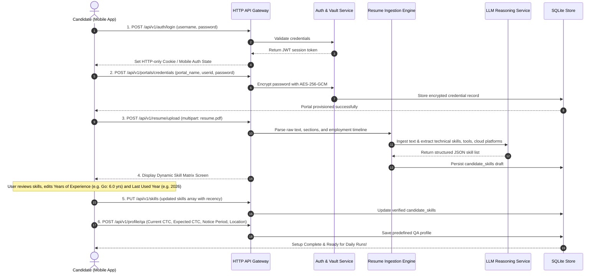

---

### 5.2 Dynamic Skill Recency & Mathematical Match Engine
Let $R$ be the canonical required skills in a job posting, and $P$ be preferred skills.
Let $C$ be the candidate's verified skill matrix. Each skill $s \in C$ possesses:
* $E(s)$: Verified Years of Experience.
* $L(s)$: Last Used Year (recency).

#### Recency Decay Multiplier $\gamma(s)$:
Let $Y_{current}$ be the current calendar year.
$$\Delta Y = Y_{current} - L(s)$$
$$\gamma(s) = \begin{cases} 
1.0 & \text{if } \Delta Y \le 1 \text{ (Actively used)} \\
0.8 & \text{if } \Delta Y = 2 \\
0.5 & \text{if } \Delta Y \ge 3 \text{ (Stale/Legacy experience)}
\end{cases}$$

#### Mathematical Scoring Model:
$$\text{Matched Required Score } S_R = \sum_{s \in R \cap C} \left(1.0 \times \gamma(s) \times \min\left(1.0, \frac{E(s)}{E_{\text{req}}(s)}\right)\right)$$
$$\text{Matched Preferred Score } S_P = \sum_{s \in P \cap C} \left(0.3 \times \gamma(s) \times \min\left(1.0, \frac{E(s)}{E_{\text{req}}(s)}\right)\right)$$
$$\text{Final Match Score } S = \frac{S_R + S_P}{|R| + 0.3 \times |P|} \ge 0.70$$

---

### 5.3 3-Tier Questionnaire Resolver & Mobile Feed Push

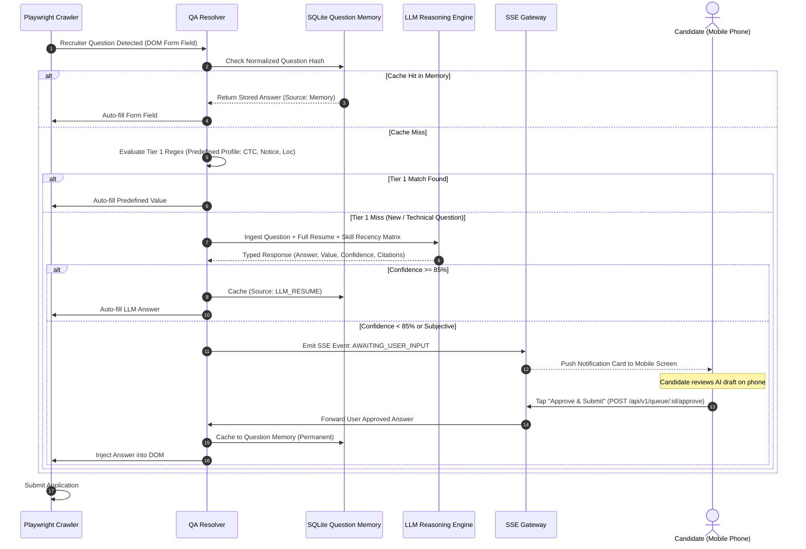

---

## 6. Data Architecture & Database Schema

The database runs on embedded **SQLite 3** configured with WAL mode (`PRAGMA journal_mode=WAL;`).

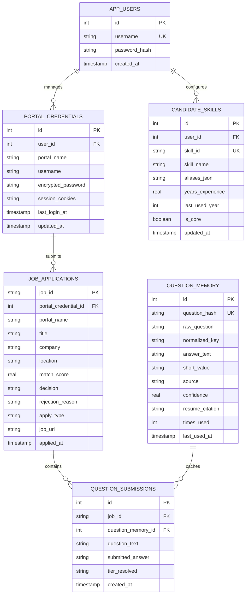

---

## 7. Security Architecture & Threat Model

Following our workspace threat-modeling methodology ([`drawbridge-threat-model`](file:///c:/ajay/GoLang/GoogleAgents/job-hunt-naukri/.gemini/skills/drawbridge-threat-model/SKILL.md)):

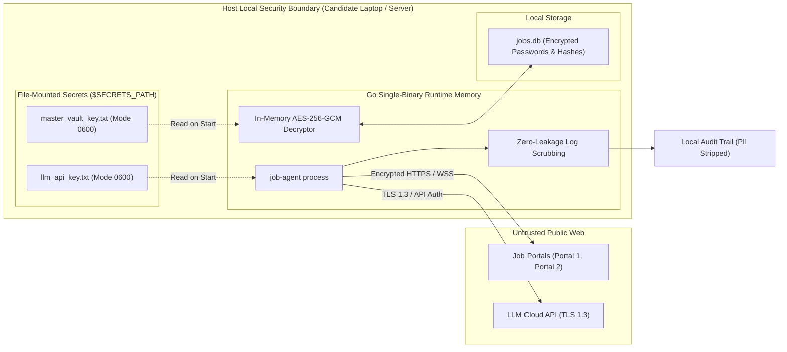

### Threat Countermeasures:
1. **Threat T-1 (Portal Password Exposure at Rest)**:
   * *Mitigation*: Passwords entered in the mobile UI are encrypted using AES-256-GCM before writing to SQLite. Master key is loaded via `go-secrets-file-mounted` from `${SECRETS_PATH}` with `0600` permissions.
2. **Threat T-2 (Account Flagging / Bot Detection)**:
   * *Mitigation*: Stealth Playwright evasions, Gaussian delay generator (8s–25s), low daily cap (5/day in pilot, 15/day in production), and instant circuit breaker pause on challenge screens.
3. **Threat T-3 (LLM Questionnaire Hallucination)**:
   * *Mitigation*: Temperature locked at `0.0`. Strict JSON schema with required citation fields. Confidence gate ($\ge 85\%$) routes any questionable output to the Mobile App Feed for 1-tap candidate approval.
4. **Threat T-4 (Inaccurate Skill Recency Mismatch)**:
   * *Mitigation*: Dynamic skill matrix lets the candidate explicitly define *Years of Experience* and *Last Used Year*, preventing accidental applications to roles requiring active recency in tools last used years ago.

---

## 8. Runtime & Process Control Surface

Aligned with [`temporal-worker-lifecycle`](file:///c:/ajay/GoLang/GoogleAgents/job-hunt-naukri/.gemini/skills/temporal-worker-lifecycle/SKILL.md), the agent offers deterministic local lifecycle control via the standard `Makefile`:

```bash
# Build the unified single binary with embedded frontend
make build

# Start the interactive Mobile UI Dashboard (opens http://localhost:8080)
make ui

# Execute the daily automated workflow in dry-run mode (scores without applying)
make dry-run

# Run the live scheduled job (Mon-Sat 09:00 trigger)
make run

# Clean and verify local database & question memory
make db-status
```

---

## 9. Data Architecture Deep Dive

### 9.1 SQLite Configuration & Pragmas
The embedded SQLite database is initialized with the following pragmas on connection initialization:

```sql
PRAGMA journal_mode=WAL;          -- Write-Ahead Logging for non-blocking concurrent reads
PRAGMA busy_timeout=5000;         -- 5s retry on SQLITE_BUSY before error
PRAGMA foreign_keys=ON;           -- Enforce referential integrity
PRAGMA synchronous=NORMAL;        -- Optimal balance of durability and write performance
PRAGMA cache_size=-32000;         -- 32MB page cache allocation
PRAGMA temp_store=MEMORY;         -- Temporary tables & indices held in memory
```

**Concurrency Model**: The Go binary configures `sql.DB` with a single dedicated write connection (`max_open_conns=1` on write handle, protected by domain mutex) and a concurrent read pool (`max_open_conns=4`). This prevents `SQLITE_BUSY` collisions between crawler transactions inserting application records and SSE streaming goroutines querying the current run status.

### 9.2 Indexing Strategy
```sql
-- Query optimization indexes
CREATE INDEX IF NOT EXISTS idx_jobs_portal_date    ON job_applications(portal_name, applied_at DESC);
CREATE INDEX IF NOT EXISTS idx_jobs_decision_score ON job_applications(decision, match_score DESC);
CREATE INDEX IF NOT EXISTS idx_skills_id           ON candidate_skills(skill_id);
CREATE INDEX IF NOT EXISTS idx_qmem_hash           ON question_memory(question_hash);
CREATE INDEX IF NOT EXISTS idx_qmem_normalized     ON question_memory(normalized_key);
```

### 9.3 Schema Migration System
```
internal/store/
├── sqlite.go              <-- Opens DB, applies pending migrations on startup
└── migrations/
    ├── 001_initial_schema.sql         <-- Base tables (users, credentials, skills, applications, memory)
    ├── 002_indexes.sql                <-- Performance indexes
    ├── 003_question_submissions.sql    <-- Question audit join table
    └── 004_schema_versions.sql        <-- Migration tracker table
```

```sql
CREATE TABLE IF NOT EXISTS schema_migrations (
    version     INTEGER PRIMARY KEY,
    name        TEXT NOT NULL,
    applied_at  TIMESTAMP NOT NULL DEFAULT CURRENT_TIMESTAMP
);
```
Migrations are embedded via `//go:embed migrations/*.sql` and applied sequentially on startup within an immediate transaction (`BEGIN IMMEDIATE`).

### 9.4 Local File Storage Layout
```
${DATA_PATH}/
├── jobs.db                          <-- SQLite database (WAL mode)
├── jobs.db-wal                      <-- WAL journal file
├── jobs.db-shm                      <-- Shared memory coordination file
├── resumes/
│   └── <user_id>/
│       ├── active/
│       │   └── resume_<timestamp>.pdf   <-- Current verified resume
│       └── archive/
│           └── resume_<timestamp>.pdf   <-- Previous versions (purged after 90 days)
├── backups/
│   ├── jobs_2026-10-20.db           <-- Daily SQLite backup (VACUUM INTO)
│   └── jobs_2026-10-21.db           <-- Rolling 7-day retention
└── logs/
    ├── agent_2026-10-20.log         <-- Daily rotated JSON log (Zerolog)
    └── agent_2026-10-21.log         <-- 30-day retention
```

### 9.5 Backup & Recovery Flow
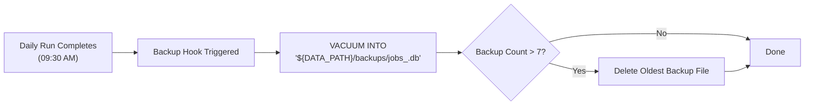
* **Recovery Procedure**: Stop binary $\rightarrow$ copy `${DATA_PATH}/backups/jobs_<date>.db` to `${DATA_PATH}/jobs.db` $\rightarrow$ restart `job-agent`.

### 9.6 Data Retention Policy
| Dataset | Retention Window | Purge Mechanism |
|---|---|---|
| `job_applications` | Indefinite | Never purged (core audit history) |
| `question_memory` | Indefinite | Persistent AI learning corpus |
| `portal_credentials.session_cookies` | 7 Days inactivity | Nullified on startup if `last_login_at < NOW() - 7d` |
| Active Resumes | Until Replaced | Superseded file moved to archive |
| Archived Resumes | 90 Days | Scheduled cleanup job during Sunday idle loop |
| Application Logs | 30 Days | Lumberjack log rotator |
| Database Backups | 7 Days | Rolling FIFO purge during post-run hook |

### 9.7 Multi-User Data Isolation
All persistent entity tables include a `user_id` foreign key referencing `app_users.id`. The JWT validation middleware injects `userID` into Go's `context.Context`. All repository queries strictly enforce `WHERE user_id = ?`:
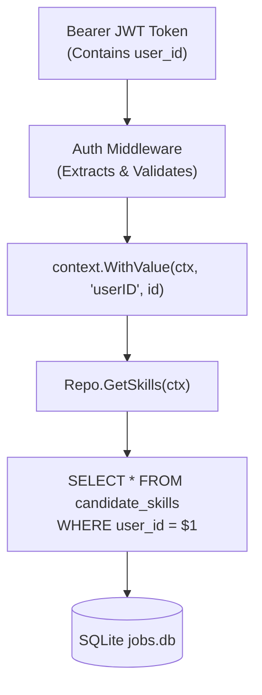

---

## 10. Phased Implementation Roadmap

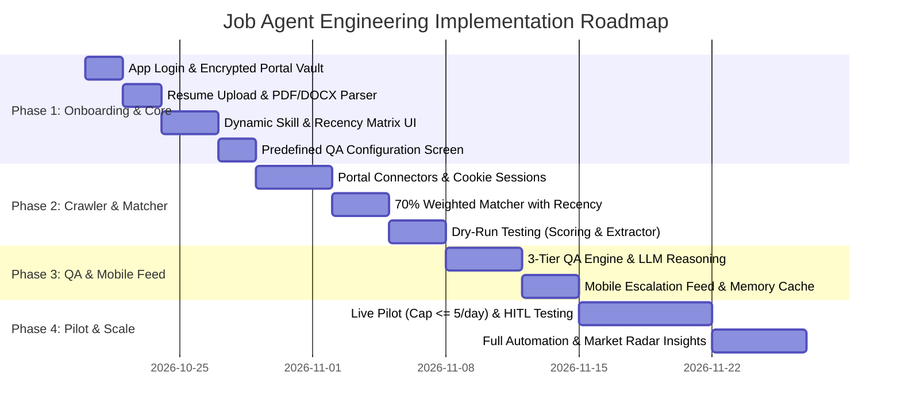

---

## 11. Deployment Architecture

### 11.1 Deployment Topology

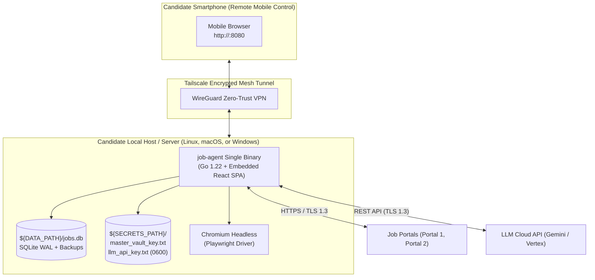

### 11.2 First-Run Bootstrap Flow

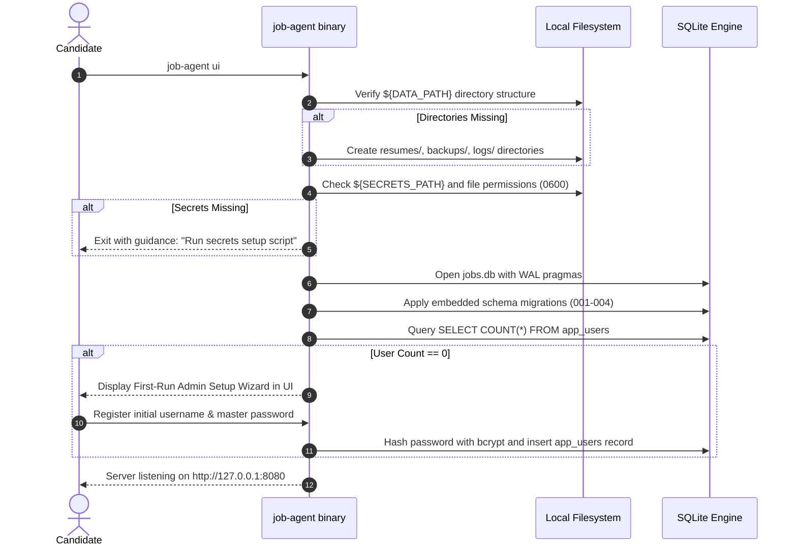

### 11.3 Secrets Provisioning Guide

**Unix / macOS / Linux**:
```bash
mkdir -p ~/.job-agent/secrets
openssl rand -hex 32 > ~/.job-agent/secrets/master_vault_key.txt
echo "YOUR_LLM_API_KEY" > ~/.job-agent/secrets/llm_api_key.txt
chmod 600 ~/.job-agent/secrets/master_vault_key.txt
chmod 600 ~/.job-agent/secrets/llm_api_key.txt
export SECRETS_PATH=~/.job-agent/secrets
```

**Windows (PowerShell)**:
```powershell
New-Item -ItemType Directory -Force "$env:USERPROFILE\.job-agent\secrets"
$key = -join ((1..32) | ForEach-Object { '{0:x2}' -f (Get-Random -Max 256) })
$key | Out-File "$env:USERPROFILE\.job-agent\secrets\master_vault_key.txt" -Encoding ASCII
"YOUR_LLM_API_KEY" | Out-File "$env:USERPROFILE\.job-agent\secrets\llm_api_key.txt" -Encoding ASCII
$env:SECRETS_PATH = "$env:USERPROFILE\.job-agent\secrets"
```

### 11.4 Environment Configuration Reference (`.env.example`)

```dotenv
# --- Storage & Secrets ---
DATA_PATH=~/.job-agent/data
SECRETS_PATH=~/.job-agent/secrets

# --- Network & Server ---
SERVER_HOST=127.0.0.1                # Set to 0.0.0.0 for LAN or Tailscale remote access
SERVER_PORT=8080

# --- LLM Provider ---
LLM_PROVIDER=gemini
LLM_MODEL=gemini-2.0-flash
LLM_TEMPERATURE=0.0                  # Locked for factual resume grounding
LLM_CONFIDENCE_THRESHOLD=0.85        # Minimum confidence for autonomous submission

# --- Match Engine & Pacing ---
MATCH_THRESHOLD=0.70                 # 70% weighted minimum score
RECENCY_WINDOW_YEARS=3               # Skills older than 3 years receive recency penalty
DAILY_CAP=5                          # Pilot cap: 5/day, Production: 15/day
SCHEDULER_CRON=0 9 * * 1-6          # Mon-Sat 09:00 AM local time

# --- Logging ---
LOG_LEVEL=info                       # debug, info, warn, error
```

### 11.5 Platform Build & Playwright Setup Matrix

```makefile
# Cross-compilation targets
build-all:
	GOOS=linux   GOARCH=amd64  go build -o dist/job-agent-linux-amd64   ./cmd/job-agent
	GOOS=darwin  GOARCH=arm64  go build -o dist/job-agent-darwin-arm64  ./cmd/job-agent
	GOOS=windows GOARCH=amd64  go build -o dist/job-agent-windows.exe   ./cmd/job-agent

# Install Playwright browser dependencies
install-browser:
	go run github.com/playwright-community/playwright-go/cmd/playwright install chromium
```

### 11.6 Tailscale Remote Mobile Access Setup

1. Install **Tailscale** on both host machine and mobile phone.
2. Sign in to the same Tailscale account to place both devices on the private WireGuard mesh.
3. Start the server with `SERVER_HOST=0.0.0.0 job-agent ui`.
4. Open the mobile smartphone browser and navigate to `http://<tailscale-ip>:8080`.
5. Tailscale ensures end-to-end encrypted transport, eliminating public internet exposure or port-forwarding risks.

---

## 12. Summary & Sign-Off

This architecture document provides a unified, production-grade technical blueprint mapping the complete customer workflow—from app login, portal credential provisioning, and resume upload to dynamic skill recency profiling, autonomous matching, 3-tier question resolution, and complete data & deployment lifecycle management.
