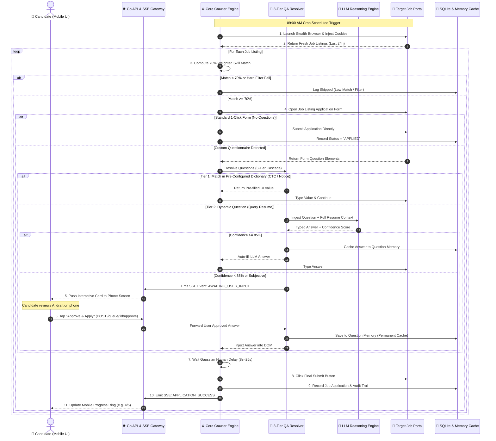

# Mobile UI Experience & Backend Sequence Guide

- **Project**: Autonomous Job-Matching Agent & Application Proxy (`job-matching-agent`)
- **Document**: Layman Mobile Walkthrough & Technical Backend Sequence Flow
- **Companion File**: [`mobile_and_sequence_visual.html`](file:///c:/ajay/GoLang/GoogleAgents/job-hunt-naukri/mobile_and_sequence_visual.html)

---

## 1. Layman Walkthrough: "A Day in the Life on Mobile"

### The Problem It Solves
Traditional scrapers run invisibly on a computer terminal. When a job portal asks an unexpected recruiter question (*"Are you currently serving notice?"* or *"Have you designed Kafka pipelines?"*), conventional bots either crash, guess randomly (causing hallucinations), or skip the job.

With this agent, **your phone acts as a 10-second approval remote control**:

```
+------------------------------------------+
|  [09:05 AM]  📱 Mobile Notification      |
|  "3 jobs auto-applied.                   |
|   1 job needs your approval (88% match)" |
+------------------------------------------+
                    |
                    v (Open Mobile Dashboard)
+------------------------------------------+
|  📱 JOB AGENT CONTROL       [ACTIVE 🟢]  |
|  Daily Cap: [■■■■■□□□] 3/5 applied       |
|------------------------------------------|
|  ⚠️ ACTION NEEDED                        |
|  Role: Staff Cloud Architect (88% Match) |
|                                          |
|  Recruiter Question:                     |
|  "Years of hands-on exp in Kafka?"       |
|                                          |
|  ✨ AI Draft (From your resume facts):   |
|  "5 years architecting event streams     |
|   with Kafka on AWS."                    |
|                                          |
|  [  ✅ APPROVE & APPLY  ]  [  SKIP  ]    |
+------------------------------------------+
                    |
                    v (Tap Approve)
+------------------------------------------+
|  🎉 Application Submitted!               |
|  Answer saved to Question Memory Cache.  |
|  (You will never be asked this again)    |
+------------------------------------------+
```

### The 4-Step Morning Routine:
1. **09:00 AM — Autonomous Wakeup**: Your computer wakes up on its daily schedule, scans new listings posted in the last 24 hours, and matches skills against your resume.
2. **09:02 AM — Auto-Apply to Easy Roles**: 1-click jobs and forms with standard questions (CTC, notice period, location) are auto-filled and submitted automatically.
3. **09:05 AM — Mobile Notification**: If a recruiter asks a novel technical question where AI confidence is borderline, your phone receives a clean approval card.
4. **09:06 AM — 1-Tap "Approve & Remember"**: You review the AI's drafted answer (pulled strictly from your resume). You tap **Approve**. The agent submits the application and permanently remembers your answer in SQLite so you are never prompted for it again.

---

## 2. Technical Backend Sequence Diagram

The following sequence details how the **Mobile Client**, **Go API Server & SSE Broker**, **Playwright Crawler**, **LLM Reasoning Engine**, and **SQLite Database** interact in real time:



---

## 3. Key Invariants & Safeguards

1. **Zero Hallucination Policy**: If an answer cannot be verified directly from your resume, the LLM will not guess; it immediately diverts the question to your phone.
2. **Permanent Question Memory**: Every question you answer on your phone is hashed and saved to SQLite. Future identical or fuzzy-matched questions are answered automatically.
3. **Anti-Bot Protection**: Between every question-fill and submission, the engine enforces randomized Gaussian human delays (8s–25s).
4. **Mobile Connectivity**: Access the dashboard from your phone via your local home Wi-Fi (`http://<local-ip>:8080`) or securely from anywhere using Tailscale / WireGuard VPN.
