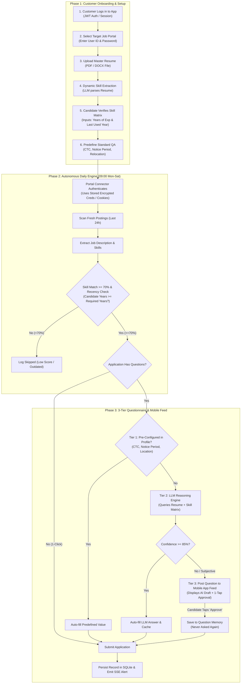
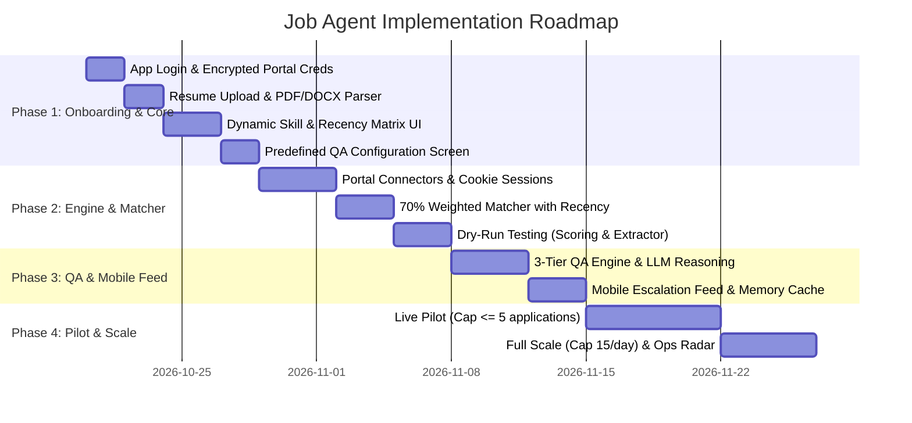

# Product Requirements Document (PRD): Automated Job-Matching Agent & Application Proxy

- **Project Name**: Autonomous Job-Matching Agent (`job-matching-agent`)
- **Primary Stakeholder / Role**: Candidate / User
- **Document Version**: 1.5.0 (Data Management, Storage & Deployment/Operational Requirements)
- **Status**: Requirements Finalization Phase (Microservice / Multi-Agent Ready)
- **Source Document**: [`Business Case_ Naukri Job-Matching Agent.html`](file:///c:/ajay/GoLang/GoogleAgents/job-hunt-naukri/Business%20Case_%20Naukri%20Job-Matching%20Agent.html)
- **Target Tech Stack**: Go 1.22+, Embedded React/Tailwind Mobile SPA (`//go:embed`), Playwright / Chrome DevTools Protocol, LLM Reasoning API (Resume Grounding), AES-256-GCM, Zerolog, SQLite

---

## 1. Traceability Matrix: User Workflow & Business Case to PRD

| User Workflow Stage | Business Case Section | PRD Requirement & Coverage | Implementation Status |
| :--- | :--- | :--- | :--- |
| **1. Customer App Login** | §1, §3 | **FR-0**: Customer Authentication & Session Management | Added |
| **2. Portal Provisioning** | §3, §5 | **FR-2**: Multi-Portal Selection & Encrypted Credential Manager | Updated |
| **3. Resume Upload** | §3, §4 | **FR-3A**: Resume Upload & Parsing Engine (PDF/DOCX) | Added |
| **4. Dynamic Skill Matrix** | §3, §4.1 | **FR-4**: Dynamic Skill Extraction, Years of Exp & Last Used Year | Updated |
| **5. Predefined QA Setup** | §4.2, §5 | **FR-6 (Tier 1)**: Predefined Screening QA Profile | Updated |
| **6. Autonomous Match & Scan** | §1, §3, §4 | **FR-1, FR-3, FR-5**: Mon–Sat 09:00 Scanner & 70% Recency Matcher | Retained & Enhanced |
| **7. Dynamic LLM QA & Memory** | §4.2, §5 | **FR-6 (Tier 2), FR-12**: LLM Resume Reasoning & Question Memory | Retained & Enhanced |
| **8. Mobile Question App Push** | §3, §4.2 | **FR-6 (Tier 3), FR-11**: Mobile Escalation Feed & 1-Tap Approvals | Updated |

---

## 2. Business Goals & Key Performance Indicators (KPIs)

| Objective | Baseline (Manual) | Target KPI | Measurement Method |
| :--- | :--- | :--- | :--- |
| **Onboarding & Setup Time** | 45–60 min per portal | $\le 5$ minutes total (Upload $\rightarrow$ Verify Skills $\rightarrow$ Go) | Time-to-first-scan metric |
| **Search & Screen Effort** | 30–60 min / day | $\ge 80\%$ reduction ($\le 10$ min / day) | Morning review time log in UI |
| **Listing-to-Apply Turnaround** | 24–72 hours | $\le 24$ hours from posting | Difference between `posted_at` and `applied_at` |
| **Application Relevance** | Inconsistent | $\ge 90\%$ judged relevant | Weekly manual audit in Match Studio |
| **Questionnaire Auto-Resolution** | 0% (Manual form filling) | $\ge 85\%$ resolved without user intervention | Audit counter: $(T_1 + T_2) / (T_1 + T_2 + T_3)$ |
| **Answer Accuracy** | Prone to typos | 100% strictly grounded in resume facts | Zero hallucinations; full citation logging |
| **Account Safety** | N/A | **Zero** CAPTCHA locks or account flags | Anti-detection metrics and zero lock events |
| **Audit Traceability** | 0% recorded | 100% of examined jobs and submitted answers logged | SQLite audit records |

---

## 3. End-to-End System Architecture & User Flow

The application is delivered as a **single, portable Go binary** (`job-agent`) serving an embedded React + Tailwind **Mobile-First SPA** (`//go:embed web/dist/*`).



---

## 4. Scope & Phasing

### 4.1 In-Scope (Phase 1 / MVP)
1. **Customer App Authentication**: Local customer login, password hashing (bcrypt), and session token management.
2. **Multi-Portal Provisioning**: Mobile UI interface to select target job portal(s) and securely input `userid` and `password`, with AES-256-GCM encryption at rest.
3. **Resume Document Ingestion**: Upload support for PDF and DOCX formats with automated text parsing.
4. **Dynamic Skill Set Profiling**: Automated extraction of skills from the resume into an interactive matrix where candidates configure **Years of Experience** and **Last Used Year**.
5. **Predefined Screening QA**: UI configuration for standard questions (Current/Expected CTC, Notice Period, Serving Notice, Relocation, Current Location, Total Experience).
6. **Autonomous Scheduled Scanner**: Mon–Sat 09:00 automated discovery and 70% weighted matching incorporating recency verification.
7. **3-Tier Questionnaire Resolver**:
   * *Tier 1*: Auto-fill predefined answers.
   * *Tier 2*: LLM reasoning grounded in resume and verified skill matrix.
   * *Tier 3*: Mobile app notification feed with pre-drafted answers and 1-tap approval.
8. **Question Memory Store**: Permanent SQLite cache storing resolved question-answer pairs.
9. **Anti-Detection Controls**: Gaussian human delays (8–25s), Playwright browser masking, and instant pause on CAPTCHA.

### 4.2 Out-of-Scope (Future Releases)
* Automated salary negotiation counters with recruiters.
* Real-time automated chatbot responses to recruiter direct messages.
* Video interview AI proxies.

---

## 5. Functional Requirements (FRs)

### FR-0: Customer Authentication, Registration & Session Management
* **Description**: Secures access to the mobile web application and enables new candidate account creation (Sign Up) so only the authorized candidate can configure credentials, view applications, or approve questions.
* **Acceptance Criteria**:
  * **Given** an unauthenticated session, **When** accessing the application, **Then** the user is presented with the Sign In screen with an option to Sign Up.
  * **Given** a new candidate, **When** clicking "Sign Up Now" and providing username, email, and master password, **Then** the password is hashed with bcrypt, saved to `app_users`, and the candidate is seamlessly transitioned to Onboarding Step 1 (Portal Vault).
  * **Given** valid existing customer credentials, **When** logging in, **Then** a secure, HTTP-only JWT session token is issued.
  * **Given** multiple devices (desktop browser and mobile browser), **When** authenticated, **Then** both maintain synchronized state via Server-Sent Events.

### FR-1: Scheduler & Trigger Management
* **Description**: Triggers execution Monday through Saturday at 09:00 AM. Automatically skips Sundays. Can also be triggered on-demand via the mobile app "Run Now" button.
* **Acceptance Criteria**:
  * **Given** Mon–Sat at 09:00 AM, **When** triggered, **Then** the portal scan and matching workflow initiates.
  * **Given** Sunday, **When** 09:00 AM arrives, **Then** execution is skipped cleanly.

### FR-2: Multi-Portal Selection & Encrypted Credential Manager
* **Description**: Allows the candidate to select target job portals (e.g. Naukri) from supported portal connectors and input their login credentials securely.
* **Acceptance Criteria**:
  * **Given** the Mobile Portal Settings screen, **When** selecting a portal (e.g. Naukri, Portal 2), **Then** the UI provides input fields for `Portal Username / User ID` and `Portal Password`.
  * **Given** entered credentials, **When** saved, **Then** the password is encrypted using AES-256-GCM before writing to the database. Plaintext passwords are never logged or stored.
  * **Given** saved portal credentials, **When** the autonomous engine initiates, **Then** the portal connector decrypts credentials in memory, performs login, and captures valid session cookies.

### FR-3A: Resume Upload & Parsing Engine
* **Description**: Ingests the candidate's master resume document to serve as the baseline factual source for matching and dynamic question answering.
* **Acceptance Criteria**:
  * **Given** a PDF or DOCX file uploaded via the mobile UI, **When** processed, **Then** the engine extracts full text, categorized sections, and work history within $\le 5$ seconds.
  * **Given** a parsed resume, **When** stored, **Then** the raw file is saved in the local data directory and structured text is made accessible to the skill extraction and LLM reasoning modules.

### FR-4: Dynamic Skill Extraction & Interactive Recency Matrix
* **Description**: Parses the uploaded resume to extract an initial skill set, presenting an interactive matrix in the UI where the candidate can adjust **Years of Experience** and **Last Used Year**.
* **Acceptance Criteria**:
  * **Given** a newly uploaded resume, **When** parsed by the extraction engine, **Then** the UI displays the extracted technical skills, frameworks, and tools.
  * **Given** each extracted skill, **When** viewed in the UI, **Then** the candidate can configure:
    1. **Skill Name & Canonical Aliases** (e.g., `Go` / `Golang`, `K8s` / `Kubernetes`).
    2. **Years of Experience** (numeric, e.g., `6.0` years).
    3. **Last Used Year** (calendar year, e.g., `2026`, `2023`).
    4. **Proficiency Level** (selection dots: `Beginner`, `Intermediate`, `Expert`).
  * **Given** the candidate reviews the matrix, **When** clicking "Save Profile", **Then** the verified skill matrix is persisted in SQLite.
  * **Given** a job description requiring $X$ years of experience in a technology, **When** matching, **Then** the match engine verifies that $\text{Candidate Exp} \ge X$ and that the skill was used within the candidate's active recency window.

### FR-5: Pass/Fail Hard Boundary Filters & Configurable Match Gate
* **Description**: Enforces non-negotiable hard criteria and candidate-configured match percentage threshold before submitting applications.
* **Acceptance Criteria**:
  * **Given** an employer in `excluded_companies` (e.g., current employer, spam agencies), **Then** the job is rejected with `REJECTED_EXCLUSION_RULE`.
  * **Given** a listing requiring total experience outside the candidate's configured band, **Then** it is rejected with `REJECTED_SENIORITY`.
  * **Given** a job outside allowed locations, **Then** it is rejected with `REJECTED_LOCATION`.
  * **Given** the Mission Control match gate percentage tab configured by the candidate (e.g. `≥60%`, `≥70%`, `≥80%`, `≥85%`), **When** evaluating discovered jobs, **Then** the agent automatically applies only to jobs whose calculated match score equals or exceeds the defined threshold.

### FR-6: 3-Tier Questionnaire Answering Engine & Mobile Feed
* **Description**: Autonomously resolves recruiter screening questions using a 3-tier cascade before submitting applications.
* **Acceptance Criteria**:
  * **Tier 1 (Predefined QA Profile)**: Standard questions matching known regex patterns (`current ctc`, `expected ctc`, `notice period`, `serving notice`, `total experience`, `location`, `relocate`) are auto-filled using candidate values configured in the UI.
  * **Tier 2 (LLM Resume & Skill Grounding)**:
    * Unmatched technical, architectural, or tool questions are submitted to the LLM with the complete resume and verified skill recency matrix as context.
    * The LLM must output: `{ answer: string, short_value: string, confidence: float, citations: string[] }`.
    * If `confidence >= 0.85`, the answer is auto-filled into the form field.
    * Hallucination Guardrail: Strict system prompt forbidding inventing facts absent from the resume.
  * **Tier 3 (Mobile App Push & 1-Tap Approval)**:
    * If `confidence < 0.85` or the question is subjective, the agent flags the listing as `REQUIRES_MANUAL_ACTION`.
    * An interactive card is posted directly to the candidate's mobile app feed displaying the question, the AI's draft suggestion, and an editable input.
    * When the candidate taps "Approve & Submit", the answer is injected, the application is submitted, and the Q&A pair is saved to Question Memory.

### FR-7: Daily Digest & Audit Trail
* **Description**: Generates a daily summary report in Markdown format and persists every evaluation decision and submitted answer to SQLite.
* **Acceptance Criteria**:
  * Detailed audit trail recording: Job ID, title, company, match score, decision, submitted answers (with tier source T1/T2/T3), and timestamps.

### FR-8: Dedicated CLI Interface (`job-agent`)
* **Description**: Provides terminal commands alongside the Mobile Web UI.
* **Acceptance Criteria**:
  * `job-agent ui`: Launches embedded web server and opens `http://localhost:8080`.
  * `job-agent run [--dry-run] [--cap N]`: Headless execution for cron schedules.
  * `job-agent resume parse --file <path>`: CLI parser to test dynamic skill extraction.

### FR-9: Market Intelligence & Skill Gap Visibility
* **Description**: Aggregates missing required skills across jobs scoring 50–69% to identify emerging tech trends.
* **Acceptance Criteria**:
  * Displays top 10 missing market skills as a visual chart in the UI and summary table in the daily digest.

### FR-10: Circuit Breaker & Safety Stop Conditions
* **Description**: Automatically halts the agent when abnormal conditions are detected.
* **Acceptance Criteria**:
  * Encountering a 403 Forbidden, Cloudflare challenge, or CAPTCHA modal immediately triggers a safety pause, broadcasts an alert to the mobile UI, and exits without brute-force retries.

### FR-11: Mobile-First Responsive Web UI
* **Description**: Responsive user interface embedded in the Go binary optimized for mobile smartphone screens and desktop browsers.
* **Acceptance Criteria**:
  * **App Login**: Clean mobile authentication screen.
  * **Portal Provisioning**: Portal selector, user ID and password management.
  * **Resume & Skill Studio**: Drag-and-drop resume upload, dynamic skill extraction cards with Years of Exp and Last Used Year steppers/inputs.
  * **Predefined QA Settings**: Form to manage CTC, notice period, location.
  * **Mobile Escalation Feed**: Card-based feed of Tier 3 questions with 1-tap "Approve & Apply" buttons.
  * **Mission Control & Kanban**: Live run progress, daily cap meter, and status board.

### FR-12: Question Memory & Cache Store
* **Description**: Persists resolved question-answer pairs to avoid asking the candidate duplicate questions in future runs.
* **Acceptance Criteria**:
  * **Given** an answer approved or entered on the mobile app, **When** stored in SQLite, **Then** any identical or fuzzy-matched question in future runs is resolved automatically without reprompting.

---

## 6. Non-Functional Requirements (NFRs)

### 6.1 Anti-Detection & Rate Limiting (Critical)
* **NFR-1.1**: Randomized Gaussian delays (8s–25s) between consecutive page requests and form interactions.
* **NFR-1.2**: Anti-detection browser flags (`navigator.webdriver` masked, realistic user-agent, human-like typing cadence).
* **NFR-1.3**: Zero parallel browser workers on the same user session.

### 6.2 LLM Reasoning & Grounding Guardrails
* **NFR-2.1**: LLM reasoning latency $\le 3.0\text{s}$ per question.
* **NFR-2.2**: Zero hallucination policy: system prompt enforces strict factual adherence to the resume.
* **NFR-2.3**: Full audit log of all generated answers, citations, and confidence scores stored in SQLite.

### 6.3 Security & Zero-Leakage Secrets
* **NFR-3.1**: Portal passwords encrypted at rest using AES-256-GCM. Session cookies and API keys read via file-mounted secrets or environment variables. Never logged or committed.
* **NFR-3.2**: Log scrubbing removes candidate phone numbers, email addresses, and auth tokens.

---

## 7. Data Models & Schemas

### 7.1 Candidate Profile with Dynamic Skill Recency (`config/candidate_profile.json`)
```json
{
  "candidate_name": "Candidate Profile",
  "min_experience_years": 8,
  "max_experience_years": 16,
  "preconfigured_answers": {
    "current_ctc_lpa": 35.0,
    "expected_ctc_lpa": 45.0,
    "notice_period_days": 30,
    "serving_notice": false,
    "total_experience_years": 11,
    "current_location": "Bangalore",
    "preferred_locations": ["Bangalore", "Remote", "Hyderabad"],
    "willing_to_relocate": true,
    "highest_qualification": "B.Tech in Computer Science",
    "holding_offers": false
  },
  "excluded_companies": ["CurrentEmployer", "ConsultancyAgency1"],
  "skills": [
    {
      "id": "go",
      "name": "Go",
      "aliases": ["Golang", "Go"],
      "years_experience": 6.0,
      "last_used_year": 2026,
      "is_core": true
    },
    {
      "id": "kubernetes",
      "name": "Kubernetes",
      "aliases": ["K8s", "Kubernetes"],
      "years_experience": 5.0,
      "last_used_year": 2026,
      "is_core": true
    },
    {
      "id": "kafka",
      "name": "Kafka",
      "aliases": ["Kafka", "Apache Kafka"],
      "years_experience": 4.5,
      "last_used_year": 2025,
      "is_core": false
    }
  ]
}
```

### 7.2 SQLite Schema (`data/jobs.db`)
```sql
-- App Customer Authentication
CREATE TABLE IF NOT EXISTS app_users (
    id INTEGER PRIMARY KEY AUTOINCREMENT,
    username TEXT UNIQUE NOT NULL,
    password_hash TEXT NOT NULL,
    created_at TIMESTAMP NOT NULL
);

-- Portal Credentials Store (Encrypted)
CREATE TABLE IF NOT EXISTS portal_credentials (
    id INTEGER PRIMARY KEY AUTOINCREMENT,
    portal_name TEXT NOT NULL,          -- e.g. "PORTAL_1", "PORTAL_2"
    username TEXT NOT NULL,
    encrypted_password TEXT NOT NULL,  -- AES-256-GCM ciphertext
    session_cookies TEXT,              -- JSON serialized cookies
    last_login_at TIMESTAMP,
    updated_at TIMESTAMP NOT NULL
);

-- Candidate Skills with Experience & Recency
CREATE TABLE IF NOT EXISTS candidate_skills (
    id INTEGER PRIMARY KEY AUTOINCREMENT,
    skill_id TEXT UNIQUE NOT NULL,
    skill_name TEXT NOT NULL,
    aliases_json TEXT NOT NULL,
    years_experience REAL NOT NULL,
    last_used_year INTEGER NOT NULL,
    is_core BOOLEAN DEFAULT FALSE,
    updated_at TIMESTAMP NOT NULL
);

-- Job Applications Audit
CREATE TABLE IF NOT EXISTS job_applications (
    job_id TEXT PRIMARY KEY,
    portal_name TEXT NOT NULL,
    title TEXT NOT NULL,
    company TEXT NOT NULL,
    location TEXT NOT NULL,
    match_score REAL NOT NULL,
    decision TEXT NOT NULL CHECK(decision IN ('APPLIED', 'SKIPPED_LOW_SCORE', 'SKIPPED_FILTER', 'MANUAL_QUEUE', 'CAP_EXCEEDED')),
    rejection_reason TEXT,
    apply_type TEXT NOT NULL,
    matched_skills TEXT,
    missing_skills TEXT,
    job_url TEXT NOT NULL,
    applied_at TIMESTAMP
);

-- Question Memory Store & Audit
CREATE TABLE IF NOT EXISTS question_memory (
    id INTEGER PRIMARY KEY AUTOINCREMENT,
    question_hash TEXT UNIQUE NOT NULL,
    raw_question TEXT NOT NULL,
    normalized_key TEXT NOT NULL,
    answer_text TEXT NOT NULL,
    source TEXT NOT NULL CHECK(source IN ('PRECONFIGURED', 'LLM_RESUME', 'HUMAN_INPUT')),
    confidence REAL NOT NULL,
    resume_citation TEXT,
    times_used INTEGER DEFAULT 1,
    last_used_at TIMESTAMP NOT NULL
);
```

---

## 8. Phased Implementation Roadmap



---

## 9. Key Decisions Confirmed

1. **User Onboarding Flow**: Complete mobile workflow approved: App Login $\rightarrow$ Portal Credential Entry (encrypted) $\rightarrow$ Resume Upload $\rightarrow$ Dynamic Skill Matrix with Years of Exp & Last Used Year $\rightarrow$ Predefined QA Setup $\rightarrow$ Autonomous Scan $\rightarrow$ Mobile Question Feed.
2. **Question Memory**: All Tier 3 manual answers cached in SQLite to prevent duplicate prompts in future runs.
3. **Safety & Anti-Ban**: 5 applications/day cap during initial 2-week pilot; 8–25s randomized human pacing; instant pause on CAPTCHA.
4. **Data Self-Containment**: All persistent state is in a single SQLite file (`jobs.db`) under `${DATA_PATH}`. No external database servers are required. WAL mode with rolling 7-day backups ensures durability without operational overhead.
5. **Deployment Model**: Single-binary local deployment on candidate's personal machine. Remote mobile access via Tailscale VPN tunnel. No cloud hosting required for MVP. Docker image available as an optional convenience.

---

## 10. Data Management & Storage Requirements

### NFR-4.1 (SQLite Indexing)
The following indexes **MUST** be created for query performance:

| Index | Table | Purpose |
|---|---|---|
| `(portal_name, applied_at DESC)` | `job_applications` | Daily digest queries |
| `(decision, match_score DESC)` | `job_applications` | Match audit queries |
| `(question_hash)` | `question_memory` | Already UNIQUE but must have explicit index |
| `(skill_id)` | `candidate_skills` | Fast lookup during matching |

### NFR-4.2 (WAL Concurrency)
SQLite must run in WAL mode (`journal_mode=WAL`) with `busy_timeout=5000ms` and `_txlock=immediate` for write transactions to prevent `SQLITE_BUSY` errors during concurrent SSE streaming and crawler write operations.

### NFR-4.3 (Schema Versioning)
A `schema_migrations` table must track applied migration versions. Migrations run automatically on binary startup using embedded SQL files. Schema must be backward-compatible within a minor version.

### NFR-4.4 (Resume File Storage)
Uploaded resume files are stored at `${DATA_PATH}/resumes/<user_id>_<timestamp>.<ext>` (PDF/DOCX). Only the latest resume per user is active; old files are retained for 90 days then purged by a scheduled cleanup job.

### NFR-4.5 (Data Retention Policy)

| Data | Retention Policy |
|---|---|
| `job_applications` records | Retained indefinitely (audit trail) |
| `question_memory` entries | Retained indefinitely (learning corpus) |
| `session_cookies` in `portal_credentials` | Purged after 7 days of inactivity; refreshed on next run |
| Application run logs (Zerolog output) | Rotated daily, retained 30 days |

### NFR-4.6 (Backup & Recovery)
The SQLite database file (`${DATA_PATH}/jobs.db`) must be backed up using SQLite's online backup API (`VACUUM INTO`) to `${DATA_PATH}/backups/jobs_<date>.db` after each successful daily run. A maximum of **7 rolling backups** are retained.

### NFR-4.7 (Multi-User Data Isolation)
All tables with per-user data (`portal_credentials`, `candidate_skills`, `job_applications`, `question_memory`) include a `user_id` foreign key referencing `app_users.id`. All repository queries must filter by the authenticated `user_id` obtained from the validated JWT claim. Cross-user data access is a security violation.

---

## 11. Deployment & Operational Requirements

### NFR-5.1 (Platform Targets)
The binary must compile and run on the following targets. Build matrix managed via `Makefile` cross-compile targets:

| Platform | `GOOS/GOARCH` | Notes |
|---|---|---|
| Linux x86-64 | `linux/amd64` | Primary — candidate's home server or laptop |
| Apple Silicon Mac | `darwin/arm64` | MacBook M-series |
| Windows 11 | `windows/amd64` | Windows 11 laptop |

### NFR-5.2 (Playwright / Browser Runtime)
The Playwright Go library requires the Chromium browser binary to be installed on the host. The `Makefile` must include a `make install-browser` target that runs `playwright install chromium`. The binary must detect a missing browser at startup and emit a clear actionable error:

```
"Run 'make install-browser' or 'job-agent install-browser' to install required browser."
```

### NFR-5.3 (First-Run Bootstrap)
On first launch (`job-agent ui` or `job-agent run`), the binary must:

1. Create the `${DATA_PATH}` directory (default: `~/.job-agent/data/`) if absent.
2. Apply all pending schema migrations automatically.
3. Detect if no `app_users` records exist and display a one-time setup wizard in the UI for creating the admin user (username + password).
4. Validate `${SECRETS_PATH}` is set and readable; if not, print a clear setup guide.

### NFR-5.4 (Secrets Provisioning)
`${SECRETS_PATH}` must point to a directory containing two files:

| File | Description |
|---|---|
| `master_vault_key.txt` | 32-byte random hex string for AES-256-GCM encryption (generate via `openssl rand -hex 32`) |
| `llm_api_key.txt` | API key for the configured LLM provider |

> [!CAUTION]
> Both files must have `0600` permissions on Unix. The binary validates permissions at startup and **refuses to start** if secrets are world-readable. On Windows, the secrets directory must be in the user profile (`%USERPROFILE%\.job-agent\secrets\`) with ACL restricted to the current user.

### NFR-5.5 (Environment Configuration)
All configuration is driven by environment variables parsed via `go-config-env` (caarlos0/env). A `.env.example` file must be maintained in the repo root.

| Variable | Default | Description |
|---|---|---|
| `DATA_PATH` | `~/.job-agent/data` | Root path for SQLite DB, resumes, backups, logs |
| `SECRETS_PATH` | `~/.job-agent/secrets` | Directory containing vault key and LLM API key |
| `SERVER_PORT` | `8080` | HTTP server listen port |
| `SERVER_HOST` | `127.0.0.1` | Bind address (use `0.0.0.0` for LAN/Tailscale) |
| `LOG_LEVEL` | `info` | Zerolog level (`debug`, `info`, `warn`, `error`) |
| `LLM_PROVIDER` | `gemini` | LLM backend provider identifier |
| `LLM_MODEL` | `gemini-2.0-flash` | Model name |
| `RECENCY_WINDOW_YEARS` | `3` | Years beyond which skill recency decays to 0.5x |
| `DAILY_CAP` | `5` | Max applications per daily run (pilot safety) |
| `SCHEDULER_CRON` | `0 9 * * 1-6` | Cron expression for Mon–Sat 09:00 |

### NFR-5.6 (Remote Access via Tailscale)
For mobile access from a smartphone, the candidate runs the agent on their home machine or server and accesses it via Tailscale VPN:

1. Install Tailscale → run `tailscale up`.
2. Access UI at `http://<tailscale-ip>:8080`.
3. Set `SERVER_HOST=0.0.0.0` to bind on all interfaces (required for Tailscale / LAN access).

> [!NOTE]
> TLS termination is out of scope for MVP. Tailscale's encrypted tunnel provides transport security for remote access.

### NFR-5.7 (Binary Distribution)

| Channel | Details |
|---|---|
| **GitHub Releases** | Pre-compiled binaries for all platform targets attached to tagged releases |
| **`go install`** | `go install github.com/<org>/job-matching-agent/cmd/job-agent@latest` |
| **Docker image** | Optional; built from `dockerfile-go` skill pattern, published to `ghcr.io/<org>/job-agent:<tag>`. Playwright in Docker requires `--no-sandbox` flag and `chromium-browser` in the base image |

### NFR-5.8 (Upgrade & Rollback)
- Schema migrations are **additive-only** (no destructive column drops in minor versions).
- Downgrade requires restoring from a backup (`${DATA_PATH}/backups/`).
- The `job-agent version` command outputs the binary version, schema migration version, and Go runtime version.

### NFR-5.9 (Port & Network Security)
- Default bind is `127.0.0.1:8080` (loopback only) — not accessible from the network unless explicitly configured.
- HTTPS/TLS is not handled by the binary in MVP; rely on Tailscale tunnel or a local reverse proxy (caddy/nginx) for HTTPS.
- CORS is restricted to the exact `Origin` of the embedded SPA in production builds.
