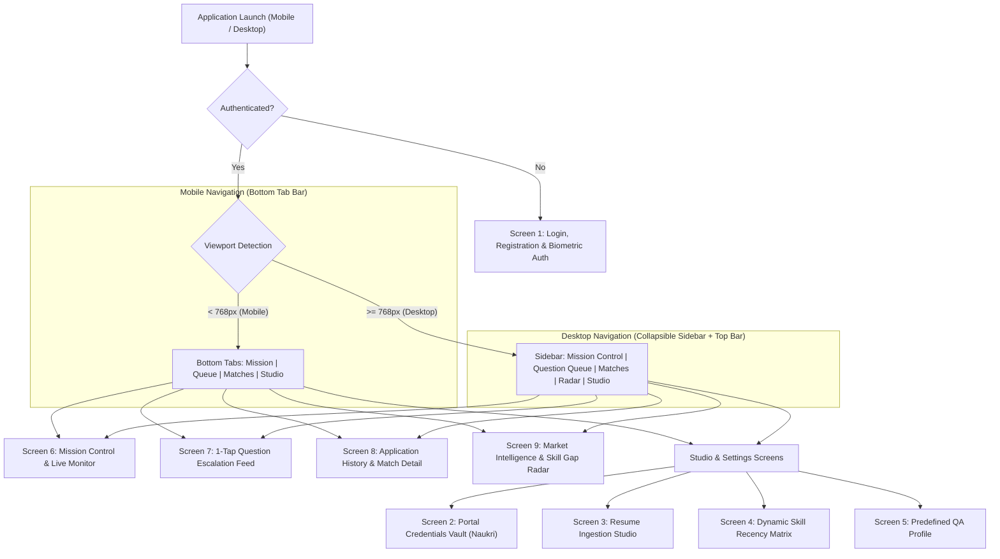

# Candidate Access Layer (Mobile & Desktop): Functional Requirements Document

- **Component**: Layer 1 — Candidate Access Layer (`ui/`)
- **System**: Autonomous Job-Matching Agent & Application Proxy
- **Target Platform**: Installed Mobile App (Mobile-First Responsive PWA / iOS & Android) & Responsive Desktop Web Dashboard (`http://localhost:8080` / Tailscale)
- **Document Version**: 1.1.0
- **Status**: Low-Level Design / UI Specification
- **Traceability**: Derives from [`REQUIREMENTS.md`](file:///c:/ajay/GoLang/GoogleAgents/job-hunt-naukri/REQUIREMENTS.md#L109-L204), [`ARCHITECTURE.md`](file:///c:/ajay/GoLang/GoogleAgents/job-hunt-naukri/ARCHITECTURE.md#L57-L91), and [`component_diagram.html`](file:///c:/ajay/GoLang/GoogleAgents/job-hunt-naukri/component_diagram.html)

---

## 1. Scope & Objective

The **Candidate Access Layer** is the dual-surface user interface between the candidate and the autonomous job agent proxy:
1. **Mobile Smartphone Experience (PWA / Installed App):** Acts as a **10-second daily approval remote control and alert center**. Designed for single-hand thumb navigation, morning glanceability, and rapid 1-tap micro-decisions.
2. **Desktop Dashboard Experience (Local Browser at `localhost:8080` or Tailscale):** Acts as an in-depth **Configuration Studio & Match Radar**. Designed for multi-column widescreen workflows: side-by-side resume vs. job description comparisons, skill matrix tuning, deep audit log analysis, and bulk data exports.

### Core Tenet
The interface operates under a **"Configure Once, Supervise in 10 Seconds"** philosophy:
1. Candidate onboards in under 5 minutes (Auth $\rightarrow$ Portal Creds $\rightarrow$ Resume Upload $\rightarrow$ Skill Recency Review $\rightarrow$ Predefined QA).
2. Daily runs execute autonomously at 09:00 AM without requiring open browser tabs.
3. The app only prompts the candidate when a high-match job ($\ge 70\%$) requires human input for an ambiguous/novel recruiter question.

---

## 2. Information Architecture & Dual Navigation Model



---

## 3. Screen-by-Screen Functional Requirements

### Screen 1: App Authentication, Secure Unlock & Sign Up (`CAL-SCR-01`)
* **Purpose**: Restrict access to the personal agent and provide onboarding registration so only the authorized candidate can view job applications, approve questions, or manage portal credentials. Displays the `"Welcome"` greeting header on the sign-in screen.
* **Functional Requirements**:
  * **FR-UI-1.1 (Credential Login)**: Provide input fields for `Username / Email` and `Master Password` with visible toggle for password masking, displaying the `"Welcome"` header, and a primary `Sign In` action.
  * **FR-UI-1.2 (Candidate Registration & Sign Up)**: Prominent `Sign Up` action allowing new candidates to register an account with `Full Name / Username`, `Email Address`, `Master Password`, and `Confirm Password`. On successful sign up, password is encrypted with bcrypt, saved to `app_users`, and the user transitions directly to Onboarding Step 1 (Portal Credentials Vault).
  * **FR-UI-1.3 (Biometric Quick Unlock)**: On supported devices (iOS FaceID/TouchID, Android Biometrics), offer 1-tap biometric unlock once the master password has been verified.
  * **FR-UI-1.4 (Session Security)**: Maintain an encrypted HTTP-only JWT token with automated background refresh. Expire sessions after 30 days of inactivity.
  * **FR-UI-1.5 (First-Run Wizard Detection)**: If the backend database contains zero users, automatically present the **Initial Account Setup / Sign Up Wizard** allowing the candidate to initialize master credentials.

### Screen 2: Portal Credentials Vault (`CAL-SCR-02`)
* **Purpose**: Allow the candidate to select supported job portals and safely input login credentials for automated browser sessions.
* **Functional Requirements**:
  * **FR-UI-2.1 (Portal Selector & Active Naukri Tab)**: Carousel/list of supported portals with `Naukri` as the default primary tab (`Naukri (Active 🟢)`), displaying active connection status badges (`Active 🟢`, `Unconfigured ⚪`, `Session Expired 🟡`, `Locked 🔴`).
  * **FR-UI-2.2 (Credential Input)**: Form inputs for `Portal User ID / Email` and `Portal Password`.
  * **FR-UI-2.3 (At-Rest Encryption Indicator)**: Explicit UI indicator showing: *"Encrypted with AES-256-GCM. Decrypted only in-memory during active morning scans."*
  * **FR-UI-2.4 (Connection Test)**: A `"Verify Login"` action button that triggers a headless background verification to validate credentials without submitting applications.
  * **FR-UI-2.5 (Cookie Refresh Status)**: Display the timestamp of the last successful session cookie capture (e.g. *"Session Valid: Refreshed today at 09:02 AM"*).

### Screen 3: Resume Ingestion Studio (`CAL-SCR-03`)
* **Purpose**: Enable mobile file upload of the master resume document (PDF / DOCX) to serve as the ground truth for job matching and question answering.
* **Functional Requirements**:
  * **FR-UI-3.1 (Document Picker)**: Native file picker supporting `.pdf` and `.docx` files (up to 10 MB).
  * **FR-UI-3.2 (Upload & Parsing Feedback)**: Animated progress indicator displaying upload progress $\rightarrow$ text extraction $\rightarrow$ LLM skill extraction.
  * **FR-UI-3.3 (Parsing Verification View)**: Once parsed, display extracted sections:
    * Candidate Name & Contact info (masked in logs).
    * Total calculated years of industry experience.
    * Work experience chronological timeline.
  * **FR-UI-3.4 (Version Management)**: Show active resume file name and upload date, with a `"Replace Resume"` button that archives previous versions.

### Screen 4: Dynamic Skill Recency Matrix (`CAL-SCR-04`)
* **Purpose**: Present skills dynamically extracted from the resume and allow the candidate to adjust years of experience and last used year to eliminate stale skill matching.
* **Functional Requirements**:
  * **FR-UI-4.1 (Skill Card Deck)**: Card list of extracted technical skills grouped into categories (*Core Languages*, *Frameworks*, *Cloud & DevOps*, *Databases*).
  * **FR-UI-4.2 (Experience Stepper)**: Numeric stepper (`-`, `+`) with 0.5-year granularity for verified **Years of Experience** (e.g., `6.5 yrs`).
  * **FR-UI-4.3 (Last Used Year Dropdown)**: Selector for the calendar year the skill was last actively utilized (e.g., `2026 (Active)`, `2024`, `2022 (Legacy)`).
  * **FR-UI-4.4 (Live Recency Badge)**: Dynamic pill indicator displaying the recency multiplier:
    * $\le 1$ year ago $\rightarrow$ `1.0x (Active)` (Emerald)
    * $2$ years ago $\rightarrow$ `0.8x (Recent)` (Amber)
    * $\ge 3$ years ago $\rightarrow$ `0.5x (Decayed/Legacy)` (Rose)
  * **FR-UI-4.5 (Core Skill Toggle)**: Star/toggle icon marking skills as `Core` (weighted higher in matching formula).
  * **FR-UI-4.6 (Custom Skill Addition)**: `"+ Add Missing Skill"` button for manually inserting technologies omitted by the parser.
  * **FR-UI-4.7 (Proficiency Level Selection Dots)**: Interactive selection dots for **Beginner**, **Intermediate**, and **Expert** on each skill card, allowing the candidate to configure explicit mastery levels alongside numeric experience years.

### Screen 5: Predefined QA Profile Settings (`CAL-SCR-05`)
* **Purpose**: Configure deterministic screening answers for standard recruiter questions so they auto-fill without invoking LLM or alerting the user.
* **Functional Requirements**:
  * **FR-UI-5.1 (Compensation Fields)**: Inputs for `Current CTC (LPA)` and `Expected CTC (LPA)` with numeric validation.
  * **FR-UI-5.2 (Notice Period Selector)**: Dropdown for Notice Period (`Immediate`, `15 Days`, `30 Days`, `60 Days`, `90 Days`).
  * **FR-UI-5.3 (Serving Notice Toggle)**: Switch indicating whether currently serving notice, with optional `Last Working Day` date picker.
  * **FR-UI-5.4 (Location & Mobility)**:
    * Current City (e.g., Bangalore).
    * Preferred Cities (multi-select tag pills).
    * `Willing to Relocate` (Toggle).
    * `Open to Remote / Hybrid` (Toggles).
  * **FR-UI-5.5 (Offer Status)**: `Holding Offer` (Toggle) and optional holding offer amount.

### Screen 6: Mission Control & Live Run Monitor (`CAL-SCR-06`)
* **Purpose**: Real-time morning operational dashboard displaying scan progress, daily quota caps, and safety states.
* **Functional Requirements**:
  * **FR-UI-6.1 (Daily Run Countdown & Status)**: Status header displaying next scheduled run (*"Next Autonomous Scan: Tomorrow 09:00 AM"*) or live run state (*"Scanning Naukri... Page 2 of 4"*).
  * **FR-UI-6.2 (Daily Cap Meter)**: Visual progress bar representing applied vs. daily cap (e.g., `3 / 5 Applied Today` in Pilot Phase).
  * **FR-UI-6.3 (On-Demand "Run Now" Trigger)**: Action button to initiate an immediate scan with modal options: `Dry-Run (Score Only)` vs. `Live Run (Apply)`.
  * **FR-UI-6.4 (Anti-Bot Safety Banner)**: Real-time safety indicator:
    * `Pacing Guard`: Current Gaussian delay countdown (e.g., *"Waiting 14s before next application..."*).
    * `Circuit Breaker`: Yellow/Red banner if challenge or CAPTCHA detected, with 1-tap `"Resume"` after manual resolution.
  * **FR-UI-6.5 (Live Event Stream)**: Live scrolling feed powered by Server-Sent Events (SSE) displaying timestamped events (`JOB_DISCOVERED`, `SCORE_CALCULATED`, `AUTO_APPLIED`, `ESCALATION_PUSHED`).
  * **FR-UI-6.6 (Auto-Apply Threshold Percentage Tabs)**: Configurable percentage tabs (`≥60%`, `≥70%`, `≥80%`, `≥85%`) allowing the candidate to customize the match percentage threshold above which the agent automatically applies for discovered jobs. Displays live count of matching opportunities.

### Screen 7: Mobile Question Escalation Feed & 1-Tap Approval (`CAL-SCR-07`)
* **Purpose**: Present ambiguous or subjective recruiter questions (Tier 3) directly to the candidate's phone for instant review and 1-tap submission.
* **Functional Requirements**:
  * **FR-UI-7.1 (Push Notification Alert)**: Native mobile notification triggered via SSE/WebPush: *"Action Required: Recruiter question on 88% match job"*.
  * **FR-UI-7.2 (Question Card Context)**: Displays:
    * Target Job Title, Company, Location, and Match Score pill (e.g., `92% Match`).
    * Full recruiter question text highlighted in bold.
  * **FR-UI-7.3 (AI Grounded Draft Answer)**: Card displays the AI's drafted response strictly extracted from the resume, with a source citation pill (e.g., *"Derived from Project XYZ in Resume"*).
  * **FR-UI-7.4 (Confidence Score Pill)**: Visual confidence tag (e.g., `Confidence: 74% — Manual Review Recommended`).
  * **FR-UI-7.5 (Editable Input Field)**: Candidate can edit the drafted text directly in the card before submitting.
  * **FR-UI-7.6 (1-Tap Action Bar)**:
    * `[ ✅ Approve & Apply ]` (Primary Emerald Action): Submits answer, resumes crawler, applies for job, and saves to Question Memory Cache.
    * `[ ⏭️ Skip Job ]` (Secondary Ghost Action): Rejects application and moves to next job.
  * **FR-UI-7.7 (Permanent Memory Checkbox)**: Pre-checked option: *"Remember this answer for future applications matching this question"*.

### Screen 8: Application History & Match Studio (`CAL-SCR-08`)
* **Purpose**: Comprehensive audit trail of all jobs scanned, evaluated, applied, or filtered out.
* **Functional Requirements**:
  * **FR-UI-8.1 (Filter Tabs)**: Quick filters: `All`, `Applied (🟢)`, `Pending Approval (🟡)`, `Skipped (⚪)`.
  * **FR-UI-8.2 (Job Card Summary)**: Lists Title, Company, Portal Name, Applied Date/Time, and Final Match Score.
  * **FR-UI-8.3 (Match Breakdown Modal)**: Tapping a card opens the detailed score inspector:
    * Matched Required Skills (with applied recency weights).
    * Missing Skills (market gap tags).
    * Questions answered with tier source (`Tier 1 Predefined`, `Tier 2 LLM`, `Tier 3 User Approved`).
  * **FR-UI-8.4 (External Portal Link)**: 1-click button to view the original posting URL in the mobile browser.

### Screen 9: Market Intelligence & Skill Gap Radar (`CAL-SCR-09`)
* **Purpose**: Aggregates missing technical skills across postings scoring 50%–69% to identify emerging high-demand technologies the candidate lacks.
* **Functional Requirements**:
  * **FR-UI-9.1 (Top 10 In-Demand Gap Chart)**: Visual horizontal bar chart ranking the top 10 technologies required by employer listings that the candidate does not have in their verified profile.
  * **FR-UI-9.2 (Opportunity Impact Metric)**: For each missing skill, display the calculated unlock potential (e.g., *"Adding Kafka Streams would qualify 6 additional listings this week"*).
  * **FR-UI-9.3 (1-Tap 'Add to Profile' Action)**: Direct link to append any identified skill directly into Screen 4 (Dynamic Skill Matrix) if the candidate recently acquired experience in it.
  * **FR-UI-9.4 (Daily Market Trend Summary)**: Exportable digest summarizing salary bands, common tech stacks, and top hiring companies from scanned jobs.

---

## 4. Desktop-Specific Ergonomics & Viewport Adaptations

When accessed via a desktop browser (`http://localhost:8080` or Tailscale), the UI transitions from single-column mobile cards to a productivity-focused widescreen workstation:

### 4.1 Responsive Breakpoint Matrix
| Breakpoint | Target Device | Layout Behavior |
| :--- | :--- | :--- |
| `< 640px` (Mobile) | Smartphones | Single-column cards, bottom navigation tab bar, modal popups. |
| `640px – 1024px` (Tablet) | iPad / Tablets | 2-column grid for metrics, collapsible icon rail navigation. |
| `> 1024px` (Desktop) | Laptops & Monitors | Fixed left sidebar navigation (240px), Master-Detail 2-pane / 3-pane split layouts. |

### 4.2 Desktop Master-Detail Split Pane
* **Split Ratio**: Left Pane (380px fixed list of jobs / queue cards) | Right Pane (Flexible viewport for full job description, parsed skill highlights, and recruiter QA editor).
* **Side-by-Side Match Studio**: Allows the candidate to view their active resume on the left half and the scraped job listing on the right half, with color-coded diff highlights:
  * 🟢 Green: Verified active skills ($\gamma = 1.0$)
  * 🟡 Amber: Verified legacy skills with decay ($\gamma = 0.5 - 0.8$)
  * 🔴 Red: Missing required job skills

### 4.3 Desktop Keyboard Shortcuts
| Shortcut Key | Action Performed | Screen Scope |
| :--- | :--- | :--- |
| `J` / `K` | Navigate down / up through job listings & queue cards | Screen 7 (Queue) & Screen 8 (Matches) |
| `A` | **Approve & Apply** for active question card | Screen 7 (Queue) |
| `S` | **Skip** active question / job listing | Screen 7 (Queue) |
| `Space` | Toggle side-by-side inspection view modal | Screen 8 (Matches) |
| `R` | Trigger **Run Scan Now** modal | Screen 6 (Mission Control) |
| `/` | Focus global search & filter bar | Screen 8 (Matches) |
| `Esc` | Close active modal or drawer | Global |

### 4.4 Desktop Data & Audit Export
* **Bulk Export Button**: Top right header offers 1-click export of the complete SQLite application history in **CSV**, **JSON**, or **Markdown Daily Digest** format.

---

## 5. Operational States, Modals & Safety Dialogs

### 5.1 Empty / Idle States
* **Zero Queue Items State (`CAL-STATE-EMPTY-QUEUE`):** When Tier 3 queue has 0 pending items, Screen 7 renders an illustration with text: *"You're all caught up! The agent auto-applied to eligible listings. Next autonomous run: Tomorrow 09:00 AM."*
* **Sunday Idle State (`CAL-STATE-SUNDAY`):** Mission Control displays a calm idle badge: *"Sunday Rest Mode — Crawler paused cleanly to emulate organic human candidate patterns."*

### 5.2 Circuit Breaker & CAPTCHA Intervention Modal (`CAL-MODAL-01`)
* **Trigger**: Triggered via Server-Sent Events when Playwright crawler detects a Cloudflare turnstile, CAPTCHA modal, or HTTP 403 Forbidden.
* **UI Behavior**:
  * Persistent Amber/Red top banner across all screens: *"⚠️ Bot Challenge Detected on Naukri — Agent Paused for Safety."*
  * Clicking the banner opens a modal displaying the exact page screenshot, with guidance:
    1. *"Open your browser to solve the challenge manually."*
    2. *"Click [ Resume Scan ] once completed."*
  * Prevents account suspension through aggressive brute-force retries.

### 5.3 Session Cookie Expiration Modal (`CAL-MODAL-02`)
* **Trigger**: When portal crawler detects invalid or expired login cookies.
* **UI Behavior**: Displays a warning card with 1-click *"Re-Authenticate Portal"* action that opens the Portal Vault with pre-filled User ID, requiring only quick password entry or OTP confirmation.

---

## 6. Frontend Component Hierarchy & API Mapping

### 6.1 React Component Structure (`web/src/components/`)
```
web/src/
├── components/
│   ├── layout/
│   │   ├── AppShell.tsx            <-- Dual layout wrapper (Sidebar for desktop, BottomNav for mobile)
│   │   ├── DesktopSidebar.tsx      <-- 240px fixed left sidebar with live badge counters
│   │   ├── MobileBottomNav.tsx     <-- Mobile 4-tab thumb navigation
│   │   └── CircuitBreakerBanner.tsx<-- Global SSE alert banner for CAPTCHA/pauses
│   ├── auth/
│   │   ├── LoginScreen.tsx         <-- Welcome login + Face ID quick unlock
│   │   └── SignUpScreen.tsx        <-- Candidate account creation
│   ├── mission/
│   │   ├── MissionControl.tsx      <-- Hero run state, pilot cap meter, and SSE log feed
│   │   └── AutoApplyThreshold.tsx  <-- Percentage tabs (≥60%, ≥70%, ≥80%, ≥85%)
│   ├── queue/
│   │   ├── QuestionQueue.tsx       <-- List of Tier 3 pending cards
│   │   └── QuestionCard.tsx        <-- Recruiter question, AI draft, 1-tap Approve & Apply
│   ├── matches/
│   │   ├── MatchHistory.tsx        <-- Master-Detail table / card feed
│   │   └── MatchInspectorModal.tsx <-- Side-by-side skill diff & question audit
│   ├── radar/
│   │   └── SkillGapRadar.tsx       <-- Screen 9 horizontal bar chart & market insights
│   └── studio/
│       ├── PortalVault.tsx         <-- Naukri credential manager (AES-256-GCM)
│       ├── ResumeStudio.tsx        <-- PDF/DOCX file picker & parsed timeline
│       ├── SkillRecencyMatrix.tsx  <-- Steppers, last used years, and level selection dots
│       └── PredefinedQAProfile.tsx <-- CTC, notice period, and relocation form
└── hooks/
    ├── useEventStream.ts           <-- Server-Sent Events broker (/api/v1/stream)
    ├── useKeyboardShortcuts.ts     <-- Desktop J/K/A/S hotkey listener
    └── useResponsiveLayout.ts      <-- Viewport breakpoint detector (< 768px vs >= 768px)
```

### 6.2 REST API & Event Mapping Matrix
| Screen / Action | HTTP Method & Path | SSE Event Triggered | Description |
| :--- | :--- | :--- | :--- |
| **Screen 1: Auth / Sign Up** | `POST /api/v1/auth/login`<br>`POST /api/v1/auth/register` | None | JWT issuance and session initialization |
| **Screen 2: Portal Vault** | `GET /api/v1/portals`<br>`POST /api/v1/portals/credentials` | None | Read portal status & write AES-256-GCM creds |
| **Screen 3: Resume Studio** | `POST /api/v1/resume/upload` | `RESUME_PARSED` | Multipart PDF/DOCX upload & extraction trigger |
| **Screen 4: Skill Matrix** | `GET /api/v1/skills`<br>`PUT /api/v1/skills` | `SKILLS_UPDATED` | Read/write verified skill recency & levels |
| **Screen 5: Predefined QA** | `GET /api/v1/profile/qa`<br>`POST /api/v1/profile/qa` | None | Read/write deterministic screening answers |
| **Screen 6: Mission Control** | `POST /api/v1/runs/start`<br>`POST /api/v1/runs/abort` | `RUN_STATE_CHANGED`<br>`LOG_EMITTED` | Trigger on-demand live or dry-run scan |
| **Screen 7: Question Feed** | `GET /api/v1/queue`<br>`POST /api/v1/queue/:id/approve` | `QUESTION_RESOLVED` | Approve AI draft, inject answer, resume crawler |
| **Screen 8: Matches** | `GET /api/v1/jobs` | `JOB_APPLIED` | Paginated listing of evaluated/applied jobs |
| **Screen 9: Skill Radar** | `GET /api/v1/analytics/skill-gaps` | None | Aggregated missing skills from 50–69% jobs |
| **Global Circuit Breaker** | `POST /api/v1/runs/circuit-breaker/resume` | `CHALLENGE_DETECTED`<br>`AGENT_RESUMED` | Alert & resume after manual CAPTCHA solve |

---

## 7. Non-Functional UI Requirements

1. **Touch & Click Ergonomics**:
   * Mobile touch targets $\ge 48\text{px} \times 48\text{px}$.
   * Safe area insets (`env(safe-area-inset-top)` and `env(safe-area-inset-bottom)`) implemented for iPhone Dynamic Island, Home Bar, and Android navigation bars.
   * Desktop layout provides natural hover states, focus rings, and tab indexing for full accessibility.
2. **Offline & Reconnection Handling**:
   * Automatic exponential backoff reconnection for Server-Sent Events (SSE).
   * Global banner: *"Reconnecting to job-agent proxy..."* with non-blocking cached state.
3. **Theme & Contrast**:
   * High-contrast Dark Mode (Slate 950 base) by default.
   * WCAG AA compliance ($\ge 4.5:1$ contrast ratio for all text elements).
4. **Performance Budgets**:
   * Mobile initial load $\le 1.2\text{s}$ over 4G mobile networks.
   * Desktop render latency $\le 200\text{ms}$ on `localhost:8080`.
   * 1-Tap approval to Playwright crawler acknowledgement $\le 300\text{ms}$.
