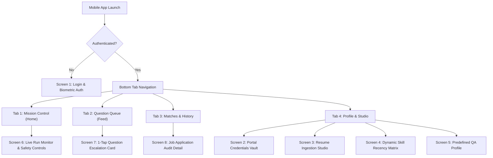

# Candidate Access Layer (Mobile App): Functional Requirements Document

- **Component**: Layer 1 — Candidate Access Layer (`ui/`)
- **System**: Autonomous Job-Matching Agent & Application Proxy
- **Target Platform**: Installed Mobile App (Mobile-First Responsive PWA / Hybrid App: iOS & Android)
- **Document Version**: 1.0.0
- **Status**: Low-Level Design / UI Specification
- **Traceability**: Derives from [`REQUIREMENTS.md`](file:///c:/ajay/GoLang/GoogleAgents/job-hunt-naukri/REQUIREMENTS.md#L109-L204), [`ARCHITECTURE.md`](file:///c:/ajay/GoLang/GoogleAgents/job-hunt-naukri/ARCHITECTURE.md#L57-L91), and [`component_diagram.html`](file:///c:/ajay/GoLang/GoogleAgents/job-hunt-naukri/component_diagram.html)

---

## 1. Scope & Objective

The **Candidate Access Layer** is the primary interface between the candidate and the autonomous job agent proxy. Installed on the user's mobile smartphone (as an iOS/Android PWA or Native Shell), it acts as a **10-second daily approval remote control and configuration studio**.

### Core Tenet
The mobile app does not require continuous attention. It operates under a **"Configure Once, Supervise in 10 Seconds"** philosophy:
1. Candidate onboards in under 5 minutes (Auth $\rightarrow$ Portal Creds $\rightarrow$ Resume Upload $\rightarrow$ Skill Recency Review $\rightarrow$ Predefined QA).
2. Daily runs happen autonomously at 09:00 AM.
3. The app only prompts the candidate when a high-match job ($\ge 70\%$) requires human input for an ambiguous/novel recruiter question.

---

## 2. Information Architecture & Navigation

---

## 3. Screen-by-Screen Functional Requirements

### Screen 1: App Authentication, Secure Unlock & Sign Up (`CAL-SCR-01`)
* **Purpose**: Restrict access to the personal agent and provide onboarding registration so only the authorized candidate can view job applications, approve questions, or manage portal credentials. Displays the `"Welcome"` greeting header on the sign-in screen.
* **Functional Requirements**:
  * **FR-UI-1.1 (Credential Login)**: Provide input fields for `Username / Email` and `Master Password` with visible toggle for password masking, displaying the `"Welcome"` header, and a primary `Sign In` action.
  * **FR-UI-1.2 (Candidate Registration & Sign Up)**: Prominent `Sign Up` action allowing new candidates to register an account with `Full Name / Username`, `Email Address`, `Master Password`, and `Confirm Password`. On successful sign up, password is encrypted with bcrypt, saved to `app_users`, and the user transitions directly to Onboarding Step 1 (Portal Credentials Vault).
  * **FR-UI-1.3 (Biometric Quick Unlock)**: On supported devices (iOS FaceID/TouchID, Android Biometrics), offer 1-tap biometric unlock once the master password has been verified.
  * **FR-UI-1.4 (Session Security)**: Maintain an encrypted HTTP-only JWT token with automated background refresh. Expire sessions after 30 days of inactivity.
  * **FR-UI-1.5 (First-Run Wizard Detection)**: If the backend database contains zero users, automatically present the **Initial Account Setup / Sign Up Wizard** allowing the candidate to initialize master credentials.

### Screen 2: Portal Credentials Vault (`CAL-SCR-02`)
* **Purpose**: Allow the candidate to select supported job portals and safely input login credentials for automated browser sessions.
* **Functional Requirements**:
  * **FR-UI-2.1 (Portal Selector & Active Naukri Tab)**: Carousel/list of supported portals with `Naukri` as the default primary tab (`Naukri (Active 🟢)`), displaying active connection status badges (`Active 🟢`, `Unconfigured ⚪`, `Session Expired 🟡`, `Locked 🔴`).
  * **FR-UI-2.2 (Credential Input)**: Form inputs for `Portal User ID / Email` and `Portal Password`.
  * **FR-UI-2.3 (At-Rest Encryption Indicator)**: Explicit UI indicator showing: *"Encrypted with AES-256-GCM. Decrypted only in-memory during active morning scans."*
  * **FR-UI-2.4 (Connection Test)**: A `"Verify Login"` action button that triggers a headless background verification to validate credentials without submitting applications.
  * **FR-UI-2.5 (Cookie Refresh Status)**: Display the timestamp of the last successful session cookie capture (e.g. *"Session Valid: Refreshed today at 09:02 AM"*).

### Screen 3: Resume Ingestion Studio (`CAL-SCR-03`)
* **Purpose**: Enable mobile file upload of the master resume document (PDF / DOCX) to serve as the ground truth for job matching and question answering.
* **Functional Requirements**:
  * **FR-UI-3.1 (Document Picker)**: Native file picker supporting `.pdf` and `.docx` files (up to 10 MB).
  * **FR-UI-3.2 (Upload & Parsing Feedback)**: Animated progress indicator displaying upload progress $\rightarrow$ text extraction $\rightarrow$ LLM skill extraction.
  * **FR-UI-3.3 (Parsing Verification View)**: Once parsed, display extracted sections:
    * Candidate Name & Contact info (masked in logs).
    * Total calculated years of industry experience.
    * Work experience chronological timeline.
  * **FR-UI-3.4 (Version Management)**: Show active resume file name and upload date, with a `"Replace Resume"` button that archives previous versions.

### Screen 4: Dynamic Skill Recency Matrix (`CAL-SCR-04`)
* **Purpose**: Present skills dynamically extracted from the resume and allow the candidate to adjust years of experience and last used year to eliminate stale skill matching.
* **Functional Requirements**:
  * **FR-UI-4.1 (Skill Card Deck)**: Card list of extracted technical skills grouped into categories (*Core Languages*, *Frameworks*, *Cloud & DevOps*, *Databases*).
  * **FR-UI-4.2 (Experience Stepper)**: Numeric stepper (`-`, `+`) with 0.5-year granularity for verified **Years of Experience** (e.g., `6.5 yrs`).
  * **FR-UI-4.3 (Last Used Year Dropdown)**: Selector for the calendar year the skill was last actively utilized (e.g., `2026 (Active)`, `2024`, `2022 (Legacy)`).
  * **FR-UI-4.4 (Live Recency Badge)**: Dynamic pill indicator displaying the recency multiplier:
    * $\le 1$ year ago $\rightarrow$ `1.0x (Active)` (Emerald)
    * $2$ years ago $\rightarrow$ `0.8x (Recent)` (Amber)
    * $\ge 3$ years ago $\rightarrow$ `0.5x (Decayed/Legacy)` (Rose)
  * **FR-UI-4.5 (Core Skill Toggle)**: Star/toggle icon marking skills as `Core` (weighted higher in matching formula).
  * **FR-UI-4.6 (Custom Skill Addition)**: `"+ Add Missing Skill"` button for manually inserting technologies omitted by the parser.
  * **FR-UI-4.7 (Proficiency Level Selection Dots)**: Interactive selection dots for **Beginner**, **Intermediate**, and **Expert** on each skill card, allowing the candidate to configure explicit mastery levels alongside numeric experience years.

### Screen 5: Predefined QA Profile Settings (`CAL-SCR-05`)
* **Purpose**: Configure deterministic screening answers for standard recruiter questions so they auto-fill without invoking LLM or alerting the user.
* **Functional Requirements**:
  * **FR-UI-5.1 (Compensation Fields)**: Inputs for `Current CTC (LPA)` and `Expected CTC (LPA)` with numeric validation.
  * **FR-UI-5.2 (Notice Period Selector)**: Dropdown for Notice Period (`Immediate`, `15 Days`, `30 Days`, `60 Days`, `90 Days`).
  * **FR-UI-5.3 (Serving Notice Toggle)**: Switch indicating whether currently serving notice, with optional `Last Working Day` date picker.
  * **FR-UI-5.4 (Location & Mobility)**:
    * Current City (e.g., Bangalore).
    * Preferred Cities (multi-select tag pills).
    * `Willing to Relocate` (Toggle).
    * `Open to Remote / Hybrid` (Toggles).
  * **FR-UI-5.5 (Offer Status)**: `Holding Offer` (Toggle) and optional holding offer amount.

### Screen 6: Mission Control & Live Run Monitor (`CAL-SCR-06`)
* **Purpose**: Real-time morning operational dashboard displaying scan progress, daily quota caps, and safety states.
* **Functional Requirements**:
  * **FR-UI-6.1 (Daily Run Countdown & Status)**: Status header displaying next scheduled run (*"Next Autonomous Scan: Tomorrow 09:00 AM"*) or live run state (*"Scanning Portal 1... Page 2 of 4"*).
  * **FR-UI-6.2 (Daily Cap Meter)**: Visual progress bar representing applied vs. daily cap (e.g., `3 / 5 Applied Today` in Pilot Phase).
  * **FR-UI-6.3 (On-Demand "Run Now" Trigger)**: Action button to initiate an immediate scan with modal options: `Dry-Run (Score Only)` vs. `Live Run (Apply)`.
  * **FR-UI-6.4 (Anti-Bot Safety Banner)**: Real-time safety indicator:
    * `Pacing Guard`: Current Gaussian delay countdown (e.g., *"Waiting 14s before next application..."*).
    * `Circuit Breaker`: Yellow/Red banner if challenge or CAPTCHA detected, with 1-tap `"Resume"` after manual resolution.
  * **FR-UI-6.5 (Live Event Stream)**: Live scrolling feed powered by Server-Sent Events (SSE) displaying timestamped events (`JOB_DISCOVERED`, `SCORE_CALCULATED`, `AUTO_APPLIED`, `ESCALATION_PUSHED`).
  * **FR-UI-6.6 (Auto-Apply Threshold Percentage Tabs)**: Configurable percentage tabs (`≥60%`, `≥70%`, `≥80%`, `≥85%`) allowing the candidate to customize the match percentage threshold above which the agent automatically applies for discovered jobs. Displays live count of matching opportunities.

### Screen 7: Mobile Question Escalation Feed & 1-Tap Approval (`CAL-SCR-07`)
* **Purpose**: Present ambiguous or subjective recruiter questions (Tier 3) directly to the candidate's phone for instant review and 1-tap submission.
* **Functional Requirements**:
  * **FR-UI-7.1 (Push Notification Alert)**: Native mobile notification triggered via SSE/WebPush: *"Action Required: Recruiter question on 88% match job"*.
  * **FR-UI-7.2 (Question Card Context)**: Displays:
    * Target Job Title, Company, Location, and Match Score pill (e.g., `92% Match`).
    * Full recruiter question text highlighted in bold.
  * **FR-UI-7.3 (AI Grounded Draft Answer)**: Card displays the AI's drafted response strictly extracted from the resume, with a source citation pill (e.g., *"Derived from Project XYZ in Resume"*).
  * **FR-UI-7.4 (Confidence Score Pill)**: Visual confidence tag (e.g., `Confidence: 74% — Manual Review Recommended`).
  * **FR-UI-7.5 (Editable Input Field)**: Candidate can edit the drafted text directly in the card before submitting.
  * **FR-UI-7.6 (1-Tap Action Bar)**:
    * `[ ✅ Approve & Apply ]` (Primary Emerald Action): Submits answer, resumes crawler, applies for job, and saves to Question Memory Cache.
    * `[ ⏭️ Skip Job ]` (Secondary Ghost Action): Rejects application and moves to next job.
  * **FR-UI-7.7 (Permanent Memory Checkbox)**: Pre-checked option: *"Remember this answer for future applications matching this question"*.

### Screen 8: Application History & Match Studio (`CAL-SCR-08`)
* **Purpose**: Comprehensive audit trail of all jobs scanned, evaluated, applied, or filtered out.
* **Functional Requirements**:
  * **FR-UI-8.1 (Filter Tabs)**: Quick filters: `All`, `Applied (🟢)`, `Pending Approval (🟡)`, `Skipped (⚪)`.
  * **FR-UI-8.2 (Job Card Summary)**: Lists Title, Company, Portal Name, Applied Date/Time, and Final Match Score.
  * **FR-UI-8.3 (Match Breakdown Modal)**: Tapping a card opens the detailed score inspector:
    * Matched Required Skills (with applied recency weights).
    * Missing Skills (market gap tags).
    * Questions answered with tier source (`Tier 1 Predefined`, `Tier 2 LLM`, `Tier 3 User Approved`).
  * **FR-UI-8.4 (External Portal Link)**: 1-click button to view the original posting URL in the mobile browser.

---

## 4. Non-Functional UI Requirements

1. **Touch Ergonomics & Safe Areas**:
   * All primary interactive targets (Approve, Run Now, Save) $\ge 48\text{px} \times 48\text{px}$.
   * Safe area insets (`env(safe-area-inset-top)` and `env(safe-area-inset-bottom)`) implemented for iPhone Dynamic Island, Home Bar, and Android navigation bars.
2. **Offline & Reconnection Handling**:
   * Automatic exponential backoff reconnection for Server-Sent Events (SSE).
   * Offline banner: *"Working Offline — Changes will sync when reconnected to agent"*.
3. **Theme & Contrast**:
   * Dual theme support: High-contrast Dark Mode (Slate 950) by default, with Light Mode toggle.
   * WCAG AA compliance ($\ge 4.5:1$ contrast ratio for all text).
4. **Performance Budgets**:
   * Initial page load $\le 1.2\text{s}$ on 4G mobile networks.
   * Approval tap to crawler acknowledgement $\le 300\text{ms}$.
